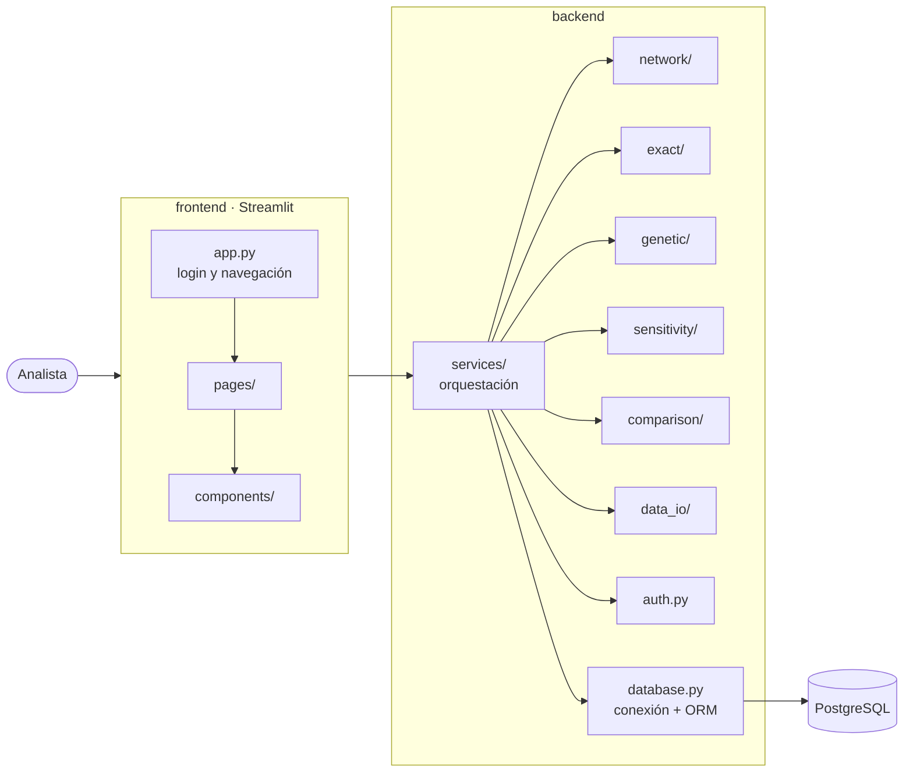

<div align="center">


# Nexus Analytics · EcoResiduos

**Sistema web de optimización de la red logística de recepción y procesamiento de residuos agropecuarios**

Modelos de redes · Problema de transporte · Simplex de dos fases · Algoritmos genéticos · Análisis de sensibilidad


*Universidad de los Llanos · Facultad de Ciencias Básicas e Ingeniería · Ingeniería de Sistemas*
*Asignatura: Optimización · Periodo académico 2026-II*

</div>

---

## Tabla de contenido

1. [Descripción](#1-descripción)
2. [Contexto del problema](#2-contexto-del-problema)
3. [Objetivos](#3-objetivos)
4. [Funcionalidades](#4-funcionalidades)
5. [Arquitectura](#5-arquitectura)
6. [Stack tecnológico](#6-stack-tecnológico)
7. [Estructura del proyecto](#7-estructura-del-proyecto)
8. [Descripción de los módulos](#8-descripción-de-los-módulos)
9. [Modelo matemático](#9-modelo-matemático)
10. [Base de datos](#10-base-de-datos)
11. [Instalación y despliegue en desarrollo (Windows)](#11-instalación-y-despliegue-en-desarrollo-windows)
12. [Uso](#12-uso)
13. [Requerimientos no funcionales clave](#13-requerimientos-no-funcionales-clave)
14. [Hoja de ruta](#14-hoja-de-ruta)
15. [Equipo y roles](#15-equipo-y-roles)
16. [Flujo de trabajo con Git](#16-flujo-de-trabajo-con-git)
17. [Documentación](#17-documentación)
18. [Licencia](#18-licencia)

---

## 1. Descripción

**Nexus Analytics · EcoResiduos** es una aplicación web que permite a **EcoResiduos del Llano S.A.S.** minimizar el costo logístico de recolectar los residuos orgánicos generados por sus empresas agropecuarias aliadas y llevarlos a sus plantas de transformación en el departamento del Meta.

El sistema modela la red como un grafo dirigido, resuelve el **problema de transporte** con un **método exacto (Simplex implementado desde cero)** y con un **Algoritmo Genético**, realiza el **análisis de sensibilidad** (precios sombra y rangos de variación) y genera un **reporte comparativo** entre ambos enfoques. Toda la lógica de optimización se construye **sin librerías de optimización**, usando únicamente **NumPy** para el cálculo matricial.

## 2. Contexto del problema

EcoResiduos del Llano S.A.S. valoriza residuos agropecuarios (biomasa, subproductos de palma, arroz, ganadería y plantaciones forestales) y los transforma en abonos orgánicos, biocombustibles y suplementos para nutrición animal.

| Elemento | Caso base |
|---|---|
| Empresas agropecuarias aliadas (orígenes) | 10 (E1 … E10) |
| Plantas de recepción y transformación (destinos) | 4: Villavicencio, Restrepo, Granada y Puerto Gaitán |
| Oferta total semanal | 1.250 t |
| Demanda total semanal | 1.250 t (problema balanceado) |
| Costo de transporte | α = 750 COP por tonelada-kilómetro |
| Precio por tonelada a cada empresa | β<sub>i</sub> = 12.000 COP/t (igual para todas en el caso base) |
| Costo unitario por ruta | c<sub>ij</sub> = α·d<sub>ij</sub> + p<sub>j</sub> + β<sub>i</sub> |
| Arcos de la red | 40 rutas empresa → planta |

La asignación empírica de rutas genera sobrecostos operativos. El sistema determina la distribución óptima de los flujos de residuos y permite **ampliar empresas y sedes**, **modificar los coeficientes del negocio** y **simular escenarios** de variación en oferta, demanda y costos.

## 3. Objetivos

**General.** Diseñar y desarrollar una solución computacional basada en modelos de optimización de redes, métodos de transporte y algoritmos genéticos para minimizar el costo logístico de la red de recepción de residuos agropecuarios.

**Específicos.**

- Estructurar y parametrizar el problema de transporte y flujo en redes con las ofertas de las 10 empresas y las demandas de las 4 plantas.
- Implementar el modelo matemático exacto para hallar la solución óptima global.
- Diseñar e implementar un Algoritmo Genético para encontrar soluciones cuasi-óptimas.
- Realizar el análisis de sensibilidad ante variaciones de costos unitarios, ofertas y demandas.
- Comparar el método exacto y el Algoritmo Genético en calidad de la función objetivo, tiempo de cómputo, escalabilidad y respuesta ante escenarios.

## 4. Funcionalidades

| Módulo | Funcionalidad | Requerimientos |
|---|---|---|
| Autenticación | Inicio de sesión con usuario y contraseña (rol **analista**) | — |
| Datos de la red | Gestión de empresas, plantas, rutas, distancias, ofertas y demandas | RF01 – RF04 |
| Parámetros | Coeficientes del negocio: costo de transporte y su factor, precio por tonelada de cada empresa (β<sub>i</sub>), costo de operación (p<sub>j</sub>) | RF05 |
| Importar / exportar | Carga y descarga de datos en CSV, XLSX y JSON | RF06 |
| Red logística | Construcción y visualización del grafo G = (V, A) | RF07 |
| Validación | Consistencia de datos y balance oferta–demanda con nodo ficticio | RF08 |
| Método exacto | Resolución con Simplex de dos fases, verificación de factibilidad | RF09, RF10 |
| Algoritmo Genético | Parámetros configurables, ejecución, múltiples corridas y estadísticas | RF11 – RF13 |
| Resultados | Flujos por arco, costo total y utilización de las plantas | RF14 |
| Sensibilidad | Precios sombra, costos reducidos y rangos de variación | RF15 |
| Escenarios | Simulación de variaciones, guardado y recuperación de escenarios | RF16, RF17 |
| Comparación | Reporte exacto vs. AG: costo, tiempo y gap % | RF18 |
| Reportes | Exportación a PDF, CSV y XLSX | RF19 |

## 5. Arquitectura

La aplicación sigue una arquitectura en capas con separación estricta entre **frontend** (presentación) y **backend** (lógica de negocio, optimización y persistencia).



**Principios de diseño**

- **Bajo acoplamiento:** los módulos de optimización (`network`, `exact`, `genetic`, `sensitivity`, `comparison`) no conocen la base de datos ni la interfaz; reciben y devuelven estructuras NumPy. Así cada integrante trabaja su módulo sin afectar los demás (RNF04).
- **Capa de servicios:** `services/` conecta la interfaz con los algoritmos y con la persistencia.
- **Persistencia con ORM:** `database.py` centraliza la conexión y los modelos ORM; ningún módulo escribe SQL directamente.
- **Escenarios inmutables:** las simulaciones crean escenarios nuevos y nunca alteran los datos originales (RNF10).
- **Patrón Singleton:** la configuración (`Settings`), la conexión a la base de datos (`Database`) y los servicios (`AuthService`, `ScenarioService`, `NetworkService`, `OptimizationService`) usan la metaclase `SingletonMeta` (`backend/utils/singleton.py`). Así toda la aplicación comparte un único motor de conexiones y una única instancia de cada servicio, aunque Streamlit atienda varias sesiones en hilos distintos.

## 6. Stack tecnológico

| Capa | Tecnología | Uso |
|---|---|---|
| Lenguaje | Python 3.11+ | Todo el sistema |
| Interfaz web | Streamlit | Páginas, formularios, tablas y gráficas |
| Cálculo | NumPy | Matrices, vectores y operaciones del Simplex, el AG y la sensibilidad |
| Grafos | NetworkX | Construcción y visualización de la red G = (V, A) |
| Visualización | Matplotlib · Plotly | Grafo, convergencia del AG, sensibilidad y comparación |
| Base de datos | PostgreSQL | Persistencia de datos, escenarios y resultados |
| ORM | SQLAlchemy 2 | Mapeo objeto-relacional en `database.py` |
| Seguridad | bcrypt | Hash de contraseñas |
| Archivos | pandas · openpyxl · fpdf2 | Lectura/escritura CSV y XLSX, reportes PDF |

> **Restricción de diseño:** el método Simplex, el método de transporte, el Algoritmo Genético y el análisis de sensibilidad se implementan **desde cero**. No se utilizan librerías de optimización (SciPy, PuLP, HiGHS, OR-Tools, DEAP, etc.); NumPy se usa solo como soporte de cálculo matricial. pandas se limita a la lectura y escritura de archivos.

## 7. Estructura del proyecto

```text
nexus-analytics-eco-residuos/
├── .streamlit/
│   └── config.toml                  # Tema y configuración de Streamlit
├── assets/
│   ├── icons/                       # Iconos SVG de navegación, KPIs, acciones y tema
│   ├── fonts/                       # Tipografía Inter (uso sin conexión, RNF12)
│   ├── images/                      # Imágenes de la aplicación (login.avif)
│   └── logo/                        # Logotipo (ecoresiduos.svg) e ícono de la pestaña (icon.svg)
├── backend/
│   ├── __init__.py
│   ├── config.py                    # Carga de variables de entorno y constantes globales
│   ├── database.py                  # Conexión a PostgreSQL y modelos ORM (SQLAlchemy)
│   ├── auth.py                      # Login: verificación de credenciales con bcrypt
│   ├── network/                     # Fase 1 · Modelado de la red
│   │   ├── __init__.py
│   │   ├── graph_builder.py         # Grafo dirigido G = (V, A) con NetworkX
│   │   ├── cost_matrix.py           # Matriz de costos c_ij = α·d_ij + p_j + β_i
│   │   └── balance.py               # Validación de datos, balance y nodos ficticios
│   ├── exact/                       # Fase 2 · Solución exacta
│   │   ├── __init__.py
│   │   ├── transport_model.py       # Formulación del PL: vector c, matriz A, vector b
│   │   ├── simplex.py               # Método Simplex de dos fases (NumPy)
│   │   └── solution_validator.py    # Verificación de factibilidad (tolerancia 1e-6)
│   ├── genetic/                     # Fase 3 · Algoritmo Genético
│   │   ├── __init__.py
│   │   ├── chromosome.py            # Codificación cromosómica de la asignación de flujos
│   │   ├── fitness.py               # Aptitud: inversa del costo penalizado
│   │   ├── selection.py             # Selección por ruleta y por torneo
│   │   ├── crossover.py             # Cruce de uno y de dos puntos
│   │   ├── mutation.py              # Operador de mutación
│   │   ├── genetic_algorithm.py     # Motor evolutivo y curva de convergencia
│   │   └── multi_run.py             # N corridas independientes y estadísticas
│   ├── sensitivity/                 # Fase 4 · Análisis de sensibilidad
│   │   ├── __init__.py
│   │   ├── duals.py                 # Precios sombra y costos reducidos
│   │   ├── ranging.py               # Rangos de optimalidad y de factibilidad
│   │   └── scenario_simulator.py    # Simulación de variaciones porcentuales
│   ├── comparison/                  # Fase 4 · Comparación exacto vs. AG
│   │   ├── __init__.py
│   │   ├── metrics.py               # Gap %, tiempos y estadísticas
│   │   └── comparative_report.py    # Construcción del reporte comparativo
│   ├── data_io/                     # Importación y exportación
│   │   ├── __init__.py
│   │   ├── importer.py              # Carga desde CSV, XLSX y JSON
│   │   ├── exporter.py              # Descarga de datos en CSV, XLSX y JSON
│   │   └── report_exporter.py       # Reportes en PDF, CSV y XLSX
│   ├── services/                    # Orquestación entre interfaz, algoritmos y BD
│   │   ├── __init__.py
│   │   ├── network_service.py       # Empresas, plantas, rutas y catálogos
│   │   ├── scenario_service.py      # Crear, copiar, guardar y recuperar escenarios
│   │   ├── optimization_service.py  # Ejecución del método exacto y del AG
│   │   ├── sensitivity_service.py   # Análisis de sensibilidad y simulaciones
│   │   └── comparison_service.py    # Comparaciones y reportes
│   └── utils/
│       ├── __init__.py
│       ├── singleton.py             # Metaclase SingletonMeta
│       ├── exceptions.py            # Excepciones del dominio (infactible, no acotado…)
│       ├── timer.py                 # Medición de tiempos de ejecución
│       └── logger.py                # Registro de eventos
├── frontend/
│   ├── __init__.py
│   ├── app.py                       # Punto de entrada: login y navegación
│   ├── pages/
│   │   ├── __init__.py
│   │   ├── inicio.py                # Panel con KPIs del escenario activo
│   │   ├── empresas.py              # Gestión de empresas (orígenes)
│   │   ├── plantas.py               # Gestión de plantas (destinos)
│   │   ├── rutas_costos.py          # Distancias y matriz de costos
│   │   ├── parametros.py            # Costo de transporte, factor, ofertas, precios, demandas y costos
│   │   ├── red_logistica.py         # Visualización del grafo
│   │   ├── escenarios.py            # Escenarios guardados: buscar, abrir, duplicar y crear
│   │   ├── metodo_exacto.py         # Ejecución y resultados del Simplex
│   │   ├── algoritmo_genetico.py    # Parámetros, ejecución y convergencia del AG
│   │   ├── sensibilidad.py          # Precios sombra, rangos y simulaciones
│   │   └── comparacion.py           # Reporte comparativo exacto vs. AG
│   ├── components/
│   │   ├── __init__.py
│   │   ├── header.py                # Barra superior: título, escenario activo, tema y usuario
│   │   ├── session.py               # Escenario activo y avisos entre páginas
│   │   ├── icons.py                 # Íconos de línea de la interfaz
│   │   ├── formatters.py            # Formato numérico colombiano
│   │   ├── login_form.py            # Formulario de inicio de sesión
│   │   ├── auth_guard.py            # Protección de páginas sin sesión
│   │   ├── sidebar.py               # Menú lateral con iconos
│   │   ├── theme_toggle.py          # Cambio de tema claro / oscuro
│   │   ├── kpi_cards.py             # Tarjetas de indicadores
│   │   ├── network_graph.py         # Render del grafo y de los flujos
│   │   ├── charts.py                # Gráficas de convergencia, sensibilidad y comparación
│   │   └── data_tables.py           # Tablas editables y de resultados
│   ├── styles/
│   │   └── main.css                 # Estilos personalizados (temas claro y oscuro)
│   └── templates/
│       └── red_interactiva.html     # Grafo interactivo sobre el mapa (simulación de fuerzas)
├── database/
│   └── ecoresiduos_db.sql           # Script DDL completo + datos del caso base
├── data/
│   └── samples/                     # Datos de prueba regionales (CSV, XLSX, JSON)
├── docs/                            # Enunciado, requerimientos, Fase 1 y MER
├── .env.example                     # Plantilla de variables de entorno
├── .gitignore
├── LICENSE
├── README.md
└── requirements.txt
```

## 8. Descripción de los módulos

### 8.1 Backend

| Paquete / archivo | Responsabilidad | Fase |
|---|---|---|
| `config.py` | Lee `.env` (conexión a la BD, entorno) y define constantes como la tolerancia numérica (1e-6). | — |
| `database.py` | Crea el *engine* y la sesión de SQLAlchemy y declara los modelos ORM que mapean las 25 tablas del MER. El resto del sistema manipula la BD a través de estos objetos, sin escribir consultas SQL. | — |
| `auth.py` | Valida usuario y contraseña contra `usuario.password_hash` (bcrypt). Solo login básico: sin registro ni recuperación de contraseña. | — |
| `network/` | Construye el grafo bipartito dirigido con NetworkX, calcula la matriz c<sub>ij</sub> y valida el balance; si ΣO<sub>i</sub> ≠ ΣD<sub>j</sub> agrega la empresa o planta ficticia. | 1 |
| `exact/` | Traduce la red a un modelo de PL en forma matricial y lo resuelve con un **Simplex de dos fases** sobre NumPy; entrega el estado (óptimo, infactible, no acotado), x<sub>ij</sub>, Z, el tiempo y la base óptima. `solution_validator.py` comprueba oferta, demanda y no negatividad. | 2 |
| `genetic/` | AG con cromosoma de asignación de flujos, aptitud = 1 / (costo + penalización por violación de capacidad), selección por ruleta o torneo, cruce de uno o dos puntos, mutación, semilla reproducible y múltiples corridas. | 3 |
| `sensitivity/` | A partir de la tabla final del Simplex calcula precios sombra, costos reducidos y rangos de variación de c<sub>ij</sub>, O<sub>i</sub> y D<sub>j</sub> que no alteran la base óptima; simula escenarios porcentuales. | 4 |
| `comparison/` | Calcula costo, tiempo y gap % = (Z<sub>AG</sub> − Z<sub>exacto</sub>) / Z<sub>exacto</sub> × 100 y arma el reporte comparativo. | 4 |
| `data_io/` | Importa y exporta los datos de entrada (CSV, XLSX, JSON) y los reportes (PDF, CSV, XLSX) en UTF-8. | 4 |
| `services/` | Casos de uso que combinan algoritmos y persistencia: crear escenarios, ejecutar métodos, guardar resultados y comparar. | — |
| `utils/` | Excepciones del dominio, cronómetro y registro de eventos. | — |

### 8.2 Frontend

| Página | Contenido | HU |
|---|---|---|
| Inicio | KPIs del escenario activo: costo total, toneladas, gap | — |
| Empresas / Plantas | CRUD de orígenes y destinos | HU-01 |
| Rutas y costos | Matriz de distancias y de costos unitarios | HU-02 |
| Parámetros | Costo de transporte, factor, ofertas, precios por tonelada, demandas y balance | HU-02, HU-03 |
| Red logística | Grafo interactivo de la red | HU-05 |
| Escenarios | Buscar, abrir, duplicar y crear escenarios derivados | HU-04, HU-10 |
| Método exacto | Ejecución del Simplex y resultados | HU-06, HU-08 |
| Algoritmo genético | Parámetros, ejecución, convergencia y estadísticas | HU-07, HU-08 |
| Sensibilidad | Precios sombra, rangos y simulación de escenarios | HU-09, HU-10 |
| Comparación | Reporte exacto vs. AG exportable | HU-11 |

## 9. Modelo matemático

Grafo bipartito dirigido $G = (V, A)$ con $V = V_O \cup V_D$ (empresas y plantas) y $A = V_O \times V_D$.

**Parámetros:** oferta $O_i$, demanda $D_j$, distancia $d_{ij}$, costo de transporte $\alpha$, costo de operación $p_j$ y precio por tonelada pagado a cada empresa $\beta_i$. El costo unitario de cada ruta es

$$
c_{ij} = \alpha\, d_{ij} + p_j + \beta_i
$$

**Variables:** $x_{ij} \ge 0$, toneladas semanales enviadas de la empresa $i$ a la planta $j$.

$$
\begin{aligned}
\min \quad & Z = \sum_{i \in V_O} \sum_{j \in V_D} c_{ij}\, x_{ij} \\
\text{s.a.} \quad & \sum_{j \in V_D} x_{ij} = O_i, && \forall\, i \in V_O \\
& \sum_{i \in V_O} x_{ij} \le D_j, && \forall\, j \in V_D \\
& x_{ij} \ge 0, && \forall\, i, j
\end{aligned}
$$

Como $c_{ij}$ ya incluye la compra, $Z$ es el costo total semanal (compra, transporte y operación). En el caso base ($\alpha = 750$, $\beta_i = 12.000$ para todas las empresas) el óptimo es **Z = 120.472.500 COP**: transporte 51.772.500, operación 53.700.000 y compra 15.000.000.

**Factor de costo de transporte:** cada escenario guarda su costo de transporte base $\alpha$ y un factor en porcentaje. El modelo usa $\alpha \cdot \text{factor} / 100$. En la página Parámetros el costo y el factor están enlazados: al cambiar uno se recalcula el otro.

Si el problema no está balanceado se agrega una empresa ficticia $E_{m+1}$ o una planta ficticia $P_{n+1}$ con costo cero. El desarrollo completo está en `docs/Fase1_Modelado_Red_Logistica.docx`.

> La interfaz está pensada para un usuario final: muestra los datos con nombres y unidades (t/semana, COP/t, COP/t·km, km), sin símbolos ni fórmulas.

## 10. Base de datos

Modelo entidad-relación normalizado hasta **tercera forma normal** (`docs/MER_EcoResiduos.drawio`), con 25 tablas agrupadas en módulos:

| Módulo | Tablas |
|---|---|
| Seguridad | `rol`, `usuario` |
| Datos maestros | `departamento`, `municipio`, `tipo_residuo`, `empresa`, `planta` |
| Escenarios | `escenario`, `escenario_empresa`, `escenario_planta`, `ruta` |
| Ejecuciones | `ejecucion`, `resultado_ruta` |
| Algoritmo Genético | `parametros_ag`, `historial_generacion` |
| Sensibilidad | `sensibilidad_oferta`, `sensibilidad_demanda`, `analisis_sensibilidad`, `punto_sensibilidad` |
| Comparación | `comparacion` |
| Catálogos | `metodo_solucion`, `estado_ejecucion`, `metodo_seleccion`, `tipo_cruce`, `tipo_parametro` |

**Dónde vive cada dato del modelo**

| Dato | Tabla y columna | Por qué ahí |
|---|---|---|
| Nombre, NIT, municipio y tipo de residuo de la empresa | `empresa` | Datos fijos de la empresa |
| Oferta semanal $O_i$ | `escenario_empresa.oferta_t_semana` | Cambia entre escenarios |
| Precio por tonelada $\beta_i$ | `escenario_empresa.precio_tonelada_cop` | Cambia entre escenarios sin alterar el caso base |
| Demanda $D_j$ y costo de operación $p_j$ | `escenario_planta` | Cambian entre escenarios |
| Costo de transporte $\alpha$ y factor | `escenario.alfa_cop_t_km`, `escenario.factor_transporte_pct` | Propios de cada escenario |
| Distancia $d_{ij}$ | `ruta.distancia_km` | Una por par empresa–planta del escenario |

**Vistas:** `v_costo_unitario` (c<sub>ij</sub> por escenario, con el factor y el precio por tonelada) y `v_comparacion` (Z exacto, Z AG, gap % y tiempos). Los valores derivados no se almacenan.

**Datos iniciales:** el script `database/ecoresiduos_db.sql` crea toda la base desde cero y carga los catálogos, el escenario **Caso base** de la Fase 1 (10 empresas con su nombre, 4 plantas y 40 rutas) y un usuario analista por defecto. Es reejecutable: elimina y vuelve a crear todos los objetos, así que **borra los datos existentes**.

## 11. Instalación y despliegue en desarrollo (Windows)

Guía para dejar el proyecto funcionando desde cero en un equipo con Windows.

### 11.1 Programas necesarios

| Programa | Versión | Descarga |
|---|---|---|
| Python | 3.11 o superior (marcar **Add python.exe to PATH** al instalar) | https://www.python.org/downloads/ |
| PostgreSQL con pgAdmin 4 | 14 o superior (el instalador incluye pgAdmin) | https://www.postgresql.org/download/windows/ |
| Git | Cualquiera reciente | https://git-scm.com/download/win |

Durante la instalación de PostgreSQL se define la contraseña del usuario `postgres`; guárdela, se usa más adelante. Deje el puerto por defecto, `5432`.

Para comprobar las instalaciones, abra **PowerShell** y ejecute:

```powershell
python --version
git --version
```

### 11.2 Crear la base de datos con pgAdmin 4

1. Abra **pgAdmin 4** y, en el panel izquierdo, despliegue **Servers → PostgreSQL**. Escriba la contraseña del usuario `postgres` si la pide.
2. Clic derecho sobre **Databases → Create → Database…**
3. En **Database** escriba `ecoresiduos`. En la pestaña **Definition** deje **Encoding** en `UTF8`. Pulse **Save**.
4. Seleccione la base `ecoresiduos` recién creada y abra **Tools → Query Tool**, o clic derecho → **Query Tool**.
5. En la barra del Query Tool pulse **Open File** (ícono de carpeta) y elija `database/ecoresiduos_db.sql` del proyecto.
6. Pulse **Execute** (ícono ▶ o tecla **F5**). Al final debe aparecer el mensaje *Query returned successfully*. Los avisos `NOTICE: ... does not exist, skipping` son normales la primera vez.
7. Para verificar, despliegue **ecoresiduos → Schemas → public → Tables**: deben aparecer 25 tablas; si no se ven, clic derecho → **Refresh**. Para ver los datos de una tabla: clic derecho → **View/Edit Data → All Rows**.

### 11.3 Descargar el proyecto y crear el entorno virtual

En PowerShell, dentro de la carpeta donde quiera el proyecto:

```powershell
git clone https://github.com/freddy-vc/nexus-analytics-eco-residuos.git
cd nexus-analytics-eco-residuos

python -m venv .venv
.venv\Scripts\Activate.ps1
```

> Si PowerShell bloquea la activación con un error de *ejecución de scripts deshabilitada*, ejecute una vez `Set-ExecutionPolicy -Scope CurrentUser RemoteSigned` y vuelva a activar. En la consola clásica (cmd) use `.venv\Scripts\activate.bat`.

Con el entorno activo (el prompt muestra `(.venv)`), instale las librerías:

```powershell
python -m pip install --upgrade pip
pip install -r requirements.txt
```

### 11.4 Configurar la conexión (archivo `.env`)

Copie la plantilla y edítela con los datos de su PostgreSQL:

```powershell
copy .env.example .env
notepad .env
```

| Variable | Descripción | Ejemplo |
|---|---|---|
| `DB_HOST` | Servidor de PostgreSQL | `localhost` |
| `DB_PORT` | Puerto | `5432` |
| `DB_NAME` | Nombre de la base de datos | `ecoresiduos` |
| `DB_USER` | Usuario de la base de datos | `postgres` |
| `DB_PASSWORD` | Contraseña definida al instalar PostgreSQL | — |
| `APP_ENV` | Entorno de ejecución | `development` |
| `APP_SECRET` | Clave para firmar la cookie de sesión (opcional; si se omite se deriva de la conexión) | una cadena larga y aleatoria |

El archivo `.env` contiene contraseñas: está en `.gitignore` y no debe subirse al repositorio.

### 11.5 Levantar la aplicación

Desde la raíz del proyecto, con el entorno virtual activo:

```powershell
streamlit run frontend/app.py
```

La aplicación se abre en `http://localhost:8501`. Para detenerla pulse **Ctrl + C** en la terminal. Después de cambiar código del backend, detenga y vuelva a ejecutar el comando.

| Usuario | Contraseña | Rol |
|---|---|---|
| `analista` | `Analista2026*` | Analista |

> Cambiar la contraseña por defecto antes de cualquier despliegue. Tras 3 intentos fallidos la cuenta se bloquea durante 1 hora.

### 11.6 Problemas frecuentes

| Síntoma | Causa y solución |
|---|---|
| «No fue posible conectar con PostgreSQL» | El servicio de PostgreSQL no está iniciado o los datos de `.env` no coinciden. Revise usuario, contraseña, puerto y que exista la base `ecoresiduos`. |
| `streamlit` no se reconoce como comando | El entorno virtual no está activo: ejecute `.venv\Scripts\Activate.ps1`. |
| Error de columnas inexistentes (`nombre`, `factor_transporte_pct`) | La base se creó con una versión anterior del script: vuelva a ejecutar `database/ecoresiduos_db.sql` (borra y recrea los datos). |
| `ConnectionResetError: [WinError 10054]` en la consola | Aviso de asyncio en Windows al cerrar una pestaña; no afecta a la aplicación. |

## 12. Uso

**Flujo de uso sugerido**

1. Iniciar sesión como analista.
2. Revisar o ajustar empresas, plantas, rutas y parámetros del **Caso base**.
3. Visualizar la red logística y validar el balance.
4. Resolver con el **método exacto**.
5. Crear escenarios derivados en **Escenarios** (duplicar o «+ Nuevo escenario»), ajustar sus parámetros y resolverlos.
6. Configurar y ejecutar el **Algoritmo Genético** (fase 3).
7. Realizar el **análisis de sensibilidad** y generar el **reporte comparativo** (fase 4).

## 13. Requerimientos no funcionales clave

| Id | Requerimiento | Criterio |
|---|---|---|
| RNF01 | Rendimiento | Método exacto < 5 s en la instancia base; AG < 60 s con parámetros por defecto; interfaz < 2 s |
| RNF02 | Escalabilidad | Al menos 100 empresas y 20 plantas sin modificar el código |
| RNF04 | Modularidad | Módulos independientes: exacto, genético, interfaz y sensibilidad |
| RNF05 | Tecnología | Método Simplex sin librerías de optimización, entorno web, PostgreSQL y `requirements.txt` |
| RNF06 | Exactitud | Restricciones satisfechas con tolerancia ≤ 1e-6 |
| RNF07 | Reproducibilidad | Semilla configurable y parámetros del AG registrados |
| RNF10 | Integridad | Las simulaciones no alteran los datos originales |
| RNF12 | Demostración | Ejecución local sin internet con casos precargados |
| RNF13 | Interoperabilidad | CSV, XLSX, JSON y PDF en UTF-8 |

## 14. Hoja de ruta

- [x] **Fase 1 · Modelado de la red:** grafo G = (V, A), parámetros y modelo de programación lineal.
- [x] Modelo entidad-relación (3FN) y script de base de datos.
- [x] Estructura del proyecto.
- [x] **Fase 2 · Solución exacta:** Simplex de dos fases con el costo de compra incluido, validación de factibilidad, interfaz de datos y resultados, y página de Escenarios.
- [ ] **Fase 3 · Metaheurística:** Algoritmo Genético y múltiples corridas.
- [ ] **Fase 4 · Interfaz, sensibilidad y comparación:** páginas de Streamlit, precios sombra, rangos, escenarios y reporte comparativo.
- [ ] Informe técnico en formato IEEE y sustentación.

## 15. Equipo y roles

| Rol | Responsabilidades | Integrante |
|---|---|---|
| Líder de proyecto / Analista de negocio | Coordinación, cronograma, informe IEEE y validación de restricciones del negocio | Angie Yessenia Gutierrez Guerrero|
| Ingeniero de modelado y optimización | Formulación matemática y módulo exacto (`network/`, `exact/`) | Cristian Fernando Muñoz Martinez |
| Desarrollador de metaheurísticas | Diseño y ajuste del Algoritmo Genético (`genetic/`) | Freddy Leonardo Vega Cisneros |
| Desarrollador de software e interfaz | Arquitectura, interfaz y módulos de sensibilidad y reportes (`frontend/`, `sensitivity/`, `comparison/`) | Juan Nicolas Cabrera Miranda |

## 16. Flujo de trabajo con Git

Se trabaja con ramas por módulo, como exige el proyecto:

| Rama | Propósito |
|---|---|
| `main` | Versión estable y entregable |
| `develop` | Integración de los módulos |
| `feature/network` | Modelado de la red |
| `feature/exact` | Simplex y método exacto |
| `feature/genetic` | Algoritmo Genético |
| `feature/sensitivity` | Análisis de sensibilidad |
| `feature/frontend` | Interfaz en Streamlit |
| `feature/database` | ORM y persistencia |

**Convención de commits:** `feat:`, `fix:`, `docs:`, `refactor:`, `chore:` seguidos de una descripción breve en español. Ejemplo: `feat(exact): implementa la fase 1 del Simplex`.

## 17. Documentación

| Archivo | Contenido |
|---|---|
| `docs/ProyectoFinal_Optimizacion_2026-2.pdf` | Enunciado del proyecto |
| `docs/Requerimientos.docx` | Requerimientos funcionales, no funcionales e historias de usuario |
| `docs/Fase1_Modelado_Red_Logistica.docx` | Modelado de la red y modelo de programación lineal |
| `docs/MER_EcoResiduos.drawio` | Modelo entidad-relación (abrir con [draw.io](https://app.diagrams.net)) |
| `database/ecoresiduos_db.sql` | Script DDL completo y datos del caso base |

## 18. Licencia

Distribuido bajo la licencia **MIT**. Ver [`LICENSE`](LICENSE).

---

<div align="center">

Proyecto académico · Optimización 2026-II · Universidad de los Llanos

</div>
